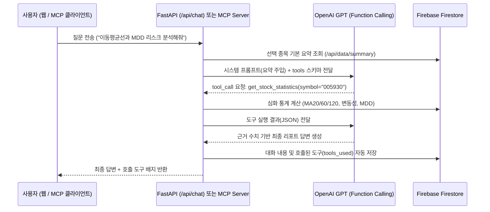
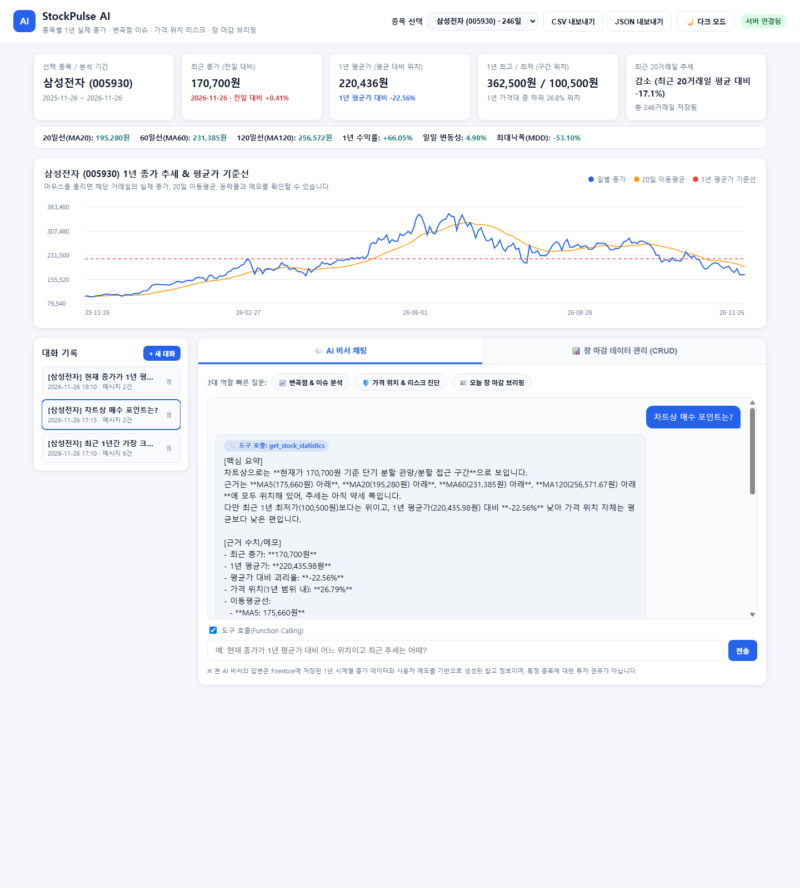

# StockPulse AI — 종목 선택형 나만의 주식 분석 AI 비서 (M1-2)

## 1. 서비스 소개
일반적인 ChatGPT는 사용자가 기록해 둔 특정 종목의 일별 수급 메모, 분할 매수 기준, 최근 1년 종가 평균 대비 현재 위치를 알지 못합니다.  
**StockPulse AI**는 **삼성전자(`005930`)**와 **두산(`000150`)**의 **오늘 날짜 기준 최근 1년 실제 과거 종가 시계열 데이터(각 240거래일+)**를 Firebase Firestore에 저장·분석하고, 선택한 종목의 요약 컨텍스트를 시스템 프롬프트에 자동 주입해 아래 **3대 통합 역할**을 수행하는 웹 AI 비서입니다.

1. **주가 변곡점 & 시장 이슈 분석 애널리스트**: 급등락 변곡점 날짜·등락률과 `[이슈]` 메모를 연결해 변동 원인을 리포트형으로 설명
2. **분할 매수 & 가격 위치 리스크 관리 비서**: 1년 평균가·최고/최저가 대비 위치(%), 이동평균선(MA20/60/120), 변동성·최대낙폭(MDD)을 근거로 가격대 리스크 점검
3. **장 마감 데일리 시황 브리핑 비서**: 매일 장 마감 종가와 `[시황]` 수급 메모를 추가(`POST /api/data`)하면 최근 5거래일 흐름을 즉시 브리핑

> ※ 본 서비스의 AI 답변은 저장된 시계열 데이터와 메모를 기반으로 생성된 참고 정보이며, 특정 종목에 대한 투자 권유가 아닙니다.

---

## 2. 기술 스택
* **Backend**: Python 3.10+, FastAPI, Uvicorn, Pydantic v2, OpenAI Python SDK (`gpt-4o-mini`), Firebase Admin SDK
* **Database**: Google Firebase Firestore (`data`, `conversations` 컬렉션)
* **Frontend**: 순수 바닐라 HTML5 / CSS3 / JavaScript (프레임워크 미사용, HTML5 `<canvas>` 자체 구현)
* **Bonus**: OpenAI Function Calling (`tools`), MCP Server (`backend/mcp_server.py`, JSON-RPC 2.0 stdio), GPT Actions (`/openapi.json`), 심화 통계 API (`/api/data/statistics`), CSV/JSON 내보내기, 다크 모드 토글
* **Deployment**: Backend — **Render**, Frontend — **Vercel**

---

## 3. 배포 URL
* **프론트엔드 (Vercel)**: https://m1-2-frontend-kwak16.vercel.app
* **백엔드 API (Render)**: https://m1-2-jcak.onrender.com
* **Swagger UI (API 문서)**: https://m1-2-jcak.onrender.com/docs

> **Render 무료 티어 콜드스타트 안내**: 무료 티어는 일정 시간 요청이 없으면 서버가 절전(Sleep) 상태가 되어 최초 요청 시 30~50초가 소요될 수 있습니다. 프론트엔드 상단 안내 배너와 65초 타임아웃으로 대응하고 있습니다.

---

## 4. 로컬 실행 방법

### 4-1. 백엔드 실행 (Windows PowerShell 기준)
```powershell
cd backend
python -m venv venv
.\venv\Scripts\Activate.ps1
pip install -r requirements.txt

# 1) 환경변수 파일 생성 후 OPENAI_API_KEY 및 Firebase 키 경로 입력
copy .env.example .env

# 2) 삼성전자·두산 최근 1년 실제 과거 종가 수집 및 Firestore 적재
#    (먼저 10건 테스트: python scripts/seed_stock_data.py --limit 10)
python scripts/seed_stock_data.py --reset

# 3) FastAPI 서버 실행
uvicorn main:app --reload
```
* 실행 후 브라우저에서 `http://127.0.0.1:8000/docs` 접속하여 Swagger UI 확인

### 4-2. 프론트엔드 실행
* `frontend/config.js`의 `API_BASE_URL`이 `http://127.0.0.1:8000`으로 설정되어 있는지 확인
* VS Code **Live Server** 확장으로 `frontend/index.html` 실행 (또는 `python -m http.server 5500 --directory frontend`)

### 4-3. 자동 검증 테스트 실행
```powershell
cd backend
.\venv\Scripts\pytest.exe -v
```

---

## 5. 환경 변수 목록 (최소 세트)

| 구분 | 변수명 | 설명 |
| :--- | :--- | :--- |
| **Backend (Render/로컬)** | `OPENAI_API_KEY` | OpenAI API 비밀 키 (`sk-...`) |
| **Backend (Render)** | `FIREBASE_SERVICE_ACCOUNT_JSON` | Firebase 서비스 계정 키 JSON 전체 문자열 |
| **Backend (로컬 대안)** | `FIREBASE_SERVICE_ACCOUNT_PATH` | 로컬 Firebase 키 파일 경로 (예: `firebase-key.json`) |
| **Backend (Render/로컬)** | `ALLOWED_ORIGINS` | CORS 허용 프론트엔드 주소 목록 (콤마 구분, 끝 `/` 제외) |
| **Frontend (Vercel)** | `API_BASE_URL` | 배포된 Render 백엔드 기본 URL (Vercel Build Command로 `config.js` 자동 주입) |

### Vercel 배포 시 Build Command (바닐라 JS 환경변수 주입)
```bash
node -e "require('fs').writeFileSync('config.js', 'window.APP_CONFIG = { API_BASE_URL: ' + JSON.stringify(process.env.API_BASE_URL || '') + ' };\n')"
```

---

## 6. 보너스 과제 — AI 도구 호출(Function Calling) 및 멀티채널(MCP / GPT Actions) 연동

### 6-1. 도구 정의 및 호출 근거
`POST /api/chat` 요청 시 기본 요약 컨텍스트 주입과 함께, GPT가 질문 의도에 따라 아래 4개 내부 도구를 능동적으로 선택·호출합니다.

| 도구명 | 호출 근거 (언제 호출되는가) | 연결 내부 기능 |
| :--- | :--- | :--- |
| `get_stock_summary` | 다른 종목 비교 또는 최신 1년 평균가·최고/최저가·추세 재확인이 필요할 때 | `GET /api/data/summary` |
| `get_stock_statistics` | 사용자가 이동평균선(MA20/60/120), 수익률, 변동성, 최대낙폭(MDD), 월별 평균을 물었을 때 | `GET /api/data/statistics` |
| `get_inflection_points` | 급등락 변곡점 날짜와 `[이슈]`/`[리스크]` 메모를 더 깊게 조회해야 할 때 | `data_service.get_inflection_points` |
| `list_recent_conversations` | 사용자가 이전에 나눴던 상담·브리핑 이력을 언급하며 조회를 요청할 때 | `GET /api/conversations` |

### 6-2. 도구 호출 흐름 다이어그램


### 6-3. 멀티채널 연동 검증 (MCP Server & GPT Actions)
1. **MCP Server (`backend/mcp_server.py`)**:
   * 표준 MCP JSON-RPC 2.0(stdio) 서버로 `get_stock_summary`, `get_stock_statistics`, `get_inflection_points`, `list_recent_conversations` 도구를 외부 클라이언트(Antigravity / Claude Desktop 등)에 노출합니다.
   * 실행: `set API_BASE_URL=https://m1-2-jcak.onrender.com && python backend/mcp_server.py`
2. **GPT Actions**:
   * FastAPI가 자동 생성하는 `https://m1-2-jcak.onrender.com/openapi.json`을 ChatGPT Custom GPT Actions 스키마에 그대로 등록해 동일 API를 외부 채널에서 호출할 수 있습니다.

---

## 7. 제출 스크린샷

### 1. 데이터 요약 + 주가 차트가 보이는 AI 채팅 화면 (질문 + 답변 + 도구 호출 배지 포함)


### 2. 장 마감 데이터 관리 화면 (CRUD 추가/수정/삭제 동작 확인)


### 3. 대화 기록 화면 (이전 대화 목록 및 특정 대화 불러오기 동작)

